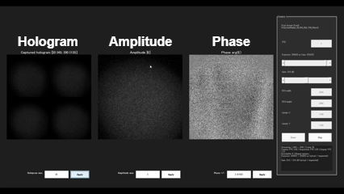
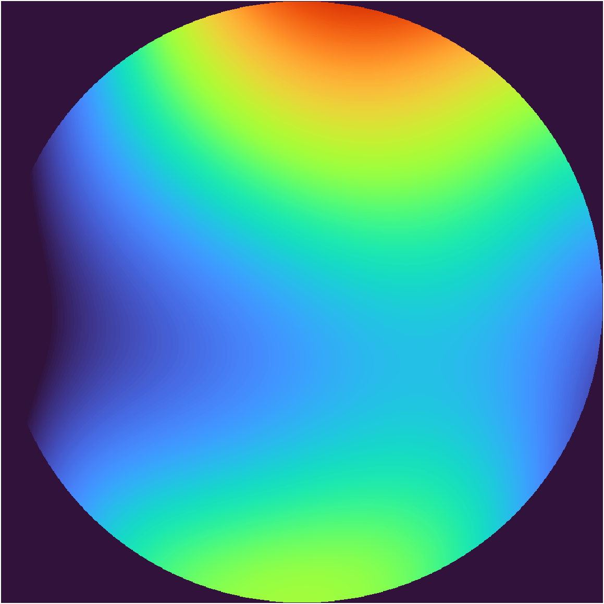
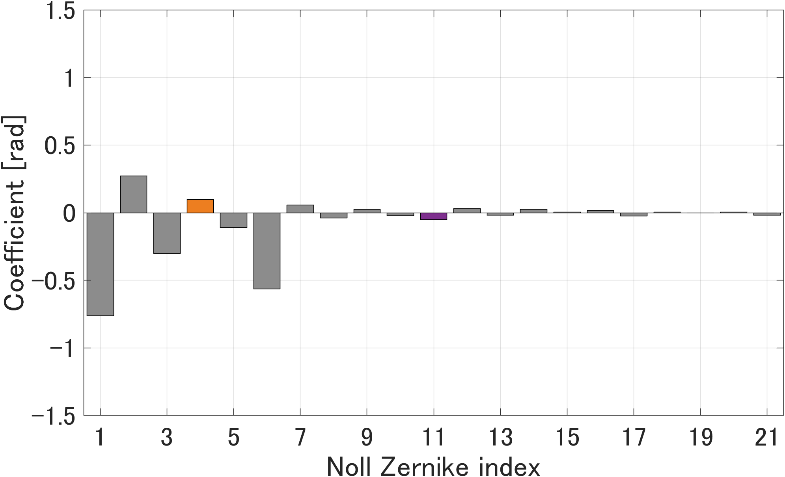

# LUCID PPSH Phase Tools

MATLAB tools for real-time parallel phase-shifting interferometry (PPSI) viewing and offline Zernike analysis of PPSH/LUCID polarization hologram data.

This repository is intended for experiments that use a LUCID polarization camera to obtain four polarization phase-shifting components and analyze the resulting wrapped phase distributions.

## What This Repository Provides

- Real-time display of hologram components, amplitude, and wrapped phase from a LUCID polarization camera
- Offline extraction of wrapped phase maps from saved hologram TIFF images
- Phase smoothing using complex-field averaging
- Zernike fitting of phase distributions up to Noll index Z21
- PNG export of selected Zernike mode distributions and all-coefficient bar charts

## Examples

<p align="center">
  
</p>

<p align="center">
  
  
</p>

## Tools

| Directory | Use When You Want To... |
| --- | --- |
| `lucid-realtime-ppsi-viewer/` | View live PPSI phase from a LUCID polarization camera. |
| `ppsh-zernike-phase-analysis/` | Analyze saved TIFF holograms and obtain Zernike coefficients. |

## Phase Reconstruction

Both tools use the same four-step PPSI reconstruction formula. For the polarization components `I0`, `I45`, `I90`, and `I135`, the complex field is calculated as:

```text
E = ((I90 - I0) + i (I135 - I45)) / 4
```

The wrapped phase is:

```text
phase = angle(E)
```

The phase range is `[-pi, pi]` before optional unwrapping in the offline Zernike analysis.

## Quick Start

### Real-time PPSI viewer

See `lucid-realtime-ppsi-viewer/README.md` for full setup details. In brief:

1. Install LUCID Arena SDK and ArenaNET.
2. Confirm the camera is detected in ArenaView.
3. Close ArenaView.
4. Build the C# bridge.
5. Start the MATLAB viewer.

Typical launch:

```powershell
cd lucid-realtime-ppsi-viewer
.\scripts\Start-LucidPpsiViewer.ps1
```

### Offline Zernike analysis

Place sample hologram TIFF files in:

```text
ppsh-zernike-phase-analysis/source/
```

Then run MATLAB in `ppsh-zernike-phase-analysis/`:

```matlab
A_extract_phase_ppsh
B_smooth_phase
C_fit_zernike
D_plot_zernike
```

The main outputs are:

```text
phase/                         # wrapped phase TIFFs
phase_16_16/                   # smoothed wrapped phase TIFFs
phase_16_16/zernike/           # Zernike coefficient CSV and settings
phase_16_16/zernike/plots/     # PNG visualizations
```

Generated analysis outputs are ignored by Git.

## Repository Layout

```text
.
├── lucid-realtime-ppsi-viewer/
│   ├── lucid_ppsi_viewer.m
│   ├── src/
│   ├── scripts/
│   └── README.md
├── ppsh-zernike-phase-analysis/
│   ├── source/
│   ├── A_extract_phase_ppsh.m
│   ├── B_smooth_phase.m
│   ├── C_fit_zernike.m
│   ├── D_plot_zernike.m
│   ├── Unwrap_TIE_DCT_Iter.m
│   └── README.md
├── README.md
├── LICENSE
├── NOTICE.md
└── .gitignore
```

## Requirements

The two tools have different requirements. See each subdirectory README for details.

Common requirements:

- MATLAB
- Image Processing Toolbox

Additional requirements for the real-time viewer:

- Windows 10 or Windows 11
- LUCID polarization camera
- LUCID Arena SDK
- ArenaNET

LUCID Arena SDK binaries, camera drivers, and vendor DLLs are not included in this repository.

## Zernike Analysis Notes

The offline tool fits phase maps with Noll-like Zernike modes up to Z21 using linear least squares. The coefficients are expressed in radians and depend on:

- ROI center
- ROI size
- circular aperture mask
- smoothing size
- unwrapping setting
- Zernike ordering and normalization

For reference-frame analysis, first fit absolute phase maps and then subtract coefficients:

```matlab
delta_coeff = coeff(frame) - coeff(reference_frame);
```

## Third-Party Components

`ppsh-zernike-phase-analysis/Unwrap_TIE_DCT_Iter.m` is an external TIE-DCT phase unwrapping implementation by Zixin Zhao. Keep its original attribution and license terms when redistributing.

The real-time viewer depends on LUCID Arena SDK and ArenaNET, which are third-party components governed by their own licenses.

See `NOTICE.md` for details.

## License

The source code written for this repository is released under the MIT License.

Third-party software and external SDKs are governed by their respective licenses.

## Publication Notes

When using this code in a publication, report the relevant acquisition and analysis settings.

For real-time PPSI measurements:

- camera model
- pixel format
- exposure time
- gain
- frame rate
- Arena SDK version

For offline Zernike analysis:

- input phase type
- smoothing size
- ROI center
- ROI size
- maximum Zernike index
- unwrapping setting
- Zernike convention

